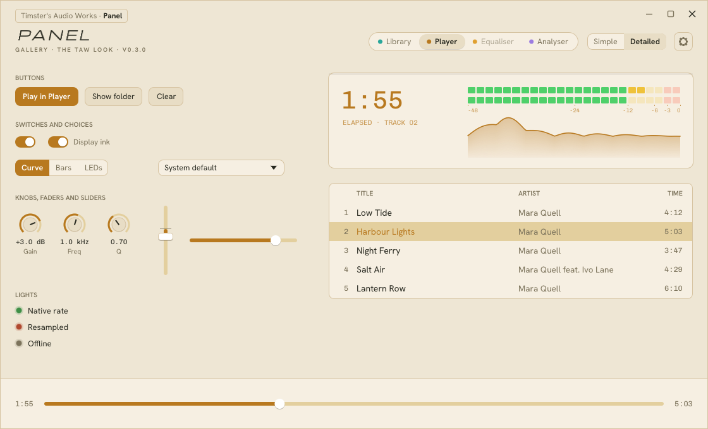
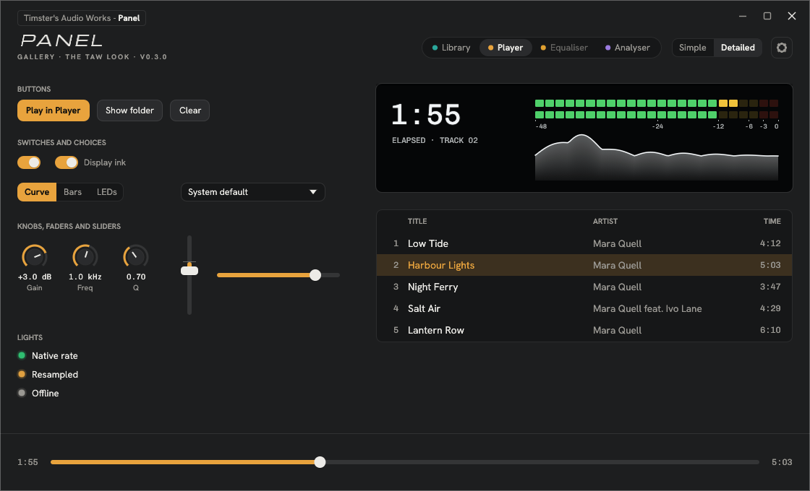
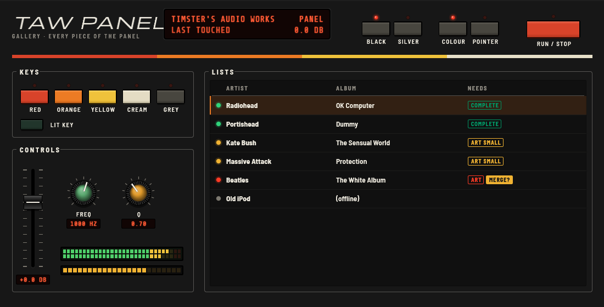

# TAW Panel

The panel look shared by Timster's Audio Works' native apps: the **Library**, **Player**, **Equaliser** and **Analyser**. One crate, so a change to the look is made once.

[FAMILY.md](FAMILY.md) describes the whole family: the apps, their names and model codes, how they fit together, and ideas parked for later. [ROADMAP.md](ROADMAP.md) is the panel's own plan, including the parked skins.



Two looks, one crate:

- **The TAW look** (`hifi`), for the hi-fi apps. Spool's warm panels by default (Light, Amber), tinted by any of Spool's seven colour themes, or Porcelain; each in Light, Dark or Automatic (following the computer). Hanken Grotesk and Chivo Mono, with Michroma for the slanted logo. The badge ("Timster's Audio Works - Player"), logo and model line stay from the original panel. Apps draw their own title strip and window buttons.
- **The Jupiter look** (`theme`, `widgets`), for the Box instruments (Drone Box, Drum Box, EQ Box): Drone Box's panel language, with Black and Silver panels, coloured keys with LEDs, knurled knobs, faders, red LED displays and the red, orange, yellow and cream stripe.





All the typefaces are built in, under the OFL.

| Module | What's in it |
|---|---|
| `hifi` | The TAW look. `Look` (`Finish`, `Build`, `Accent`) and the `Tokens` it resolves to; `install_fonts`, `apply_visuals`; `faceplate`, `bar`, `well`, `display`; `nameplate`, `window_buttons`, `drag_to_move`, `resize_edges`; `button`, `switch`, `labelled_switch`, `segmented`, `family_switch`, `gear_button`, `select`, `knob`, `vfader`, `hslider`, `meter`, `meter_scale`, `status_light`, `ink_text`, `ink_curve`; `drawer` and `look_settings` |
| `theme` | The Jupiter look: `Theme` (Black or Silver), `KnobStyle`, the key colours (`K_RED` … `K_GREY`), lights and display colours, `install_fonts` and `font` |
| `widgets` | Jupiter controls: `key`, `lit_key`, `knob`, `fader`, `lcd`, `lcd_combo`, `readout`, `meter`, `ladder`, `section`, `frame_tab`, `stripe`, `led`, text helpers; and `Spec`, the range of a control, used by both looks |
| `lists` | `rows` (a scrolling list that only draws what's on screen), `fit`, `thousands`, `ago`, and Jupiter list pieces (`well`, `row_bg`, `header`, `chip`, `light`) |
| `frame` | `draw_panel_bg` and `fit_to_window` |
| `spectrum` | `draw` a spectrum in a `Scheme` (red, amber, green, ice, white, rainbow, heat) and `Look` (fill, line or both) |
| `analyzer` | `Analyzer` and `Ballistics`: the FFT behind a spectrum display. Turn on with `features = ["analyser"]` |

## Using it

```toml
[dependencies]
# 0.3.0
taw-panel = { git = "https://github.com/TimsterAudio/TAW-Panel", rev = "1b8162d75d10c41a8c9b021fc3d31e2a3311aeb6" }
```

```rust
use taw_panel::hifi::{self, Tokens};

hifi::install_fonts(&cc.egui_ctx);                 // once, at start-up
let t = Tokens::from_ctx(ctx, &saved.look);         // each frame
hifi::apply_visuals(ctx, &t);
hifi::faceplate(ui.painter(), ui.max_rect(), &t);
```

Apps pin an exact commit (`rev`, with the version in a comment), so a new version of the panel only reaches an app when that app moves to it. CHANGELOG.md lists each version's commit.

## Seeing every piece

```sh
cargo run --example gallery                    # the TAW look
cargo run --example gallery -- porcelain dark  # starting on another look
cargo run --example jupiter                    # the Box instruments' look
```
